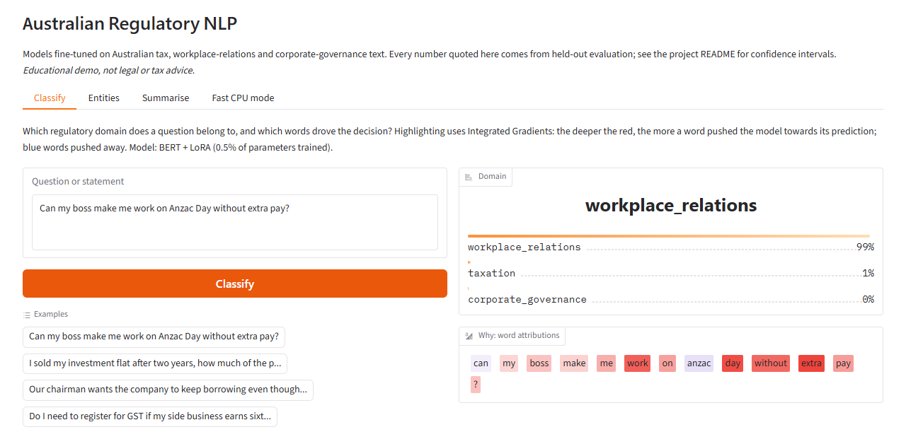
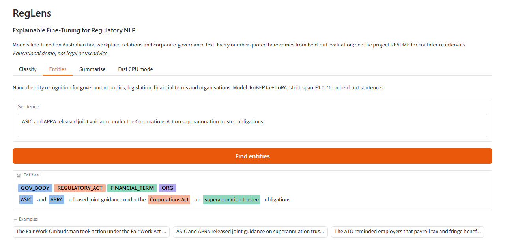

# RegLens: Explainable Fine-Tuning for Regulatory NLP 

Parameter-efficient transformer fine-tuning on Australian regulatory text (taxation, workplace relations and corporate governance). The suite covers sequence classification, named entity recognition, extractive question answering, domain-adaptive pre-training, knowledge distillation, multi-task learning, abstractive summarisation, token attribution, ONNX / INT8 deployment and MLflow experiment tracking. Every number below comes from a run on held-out data, with 95% confidence intervals.

Quick links: [Repository](https://github.com/ManuSasikanthOruvilakode1/RegLens-Explainable-Fine-Tuning-for-Regulatory-NLP) | [License (Apache-2.0)](LICENSE)

The datasets are small and hand-curated, because the goal is to compare methods honestly under low-resource conditions rather than to chase leaderboard scores. The confidence intervals are wide for that reason, and the results tables show them.



<table><tr>
<td></td>
<td></td>
</tr></table>

*Local web demo (`uv run python src/ui.py`): domain classification with Integrated Gradients highlighting, entity recognition, before/after summarisation and an INT8 CPU mode. See [Demo](#demo).*

---

## Results at a glance

| Task | Best system | Held-out score | Reference |
|---|---|---|---|
| Classification (in-distribution test, n=42) | QLoRA / full FT (`bert-base-uncased`) | 98.4% accuracy (3-seed mean) | TF-IDF + LogReg: 81.0% |
| Classification (plain-English challenge, n=30) | LoRA with re-initialised pooler | **83.3 ± 0.0%** (DAPT encoder: 87.8 ± 4.2%) | Standard LoRA: 63.3 ± 9.8% |
| NER, strict span-F1 (25 test entities) | `roberta-base` + LoRA | 0.708 [0.569, 0.842] | Gazetteer: 0.375 [0.180, 0.500] |
| Summarisation (12 unseen passages) | `flan-t5-base` + LoRA | ROUGE-L 0.376 [0.315, 0.428] | Lead sentence: 0.301; zero-shot: 0.227 |
| CPU deployment | ONNX Runtime, dynamic INT8 | 2.87x faster, 4x smaller | 94.4% prediction agreement with PyTorch |
| Extractive QA (13 questions, unseen contexts) | `roberta-base`, QA only | EM 0.538 ± 0.063, F1 0.729 ± 0.031 (3 seeds) | — |

Detailed reports are in [`results/`](results/).

---

## Data

All text is original, written to paraphrase public regulatory guidance. None of it contains personal information. `scripts/build_datasets.py` builds every split deterministically (seed 42) from the files in `data/raw/`.

| Dataset | Source file | Splits | Leakage control |
|---|---|---|---|
| Classification (3 classes) | `classification_corpus.tsv` (168 sentences) | 102 / 24 / 42 train / dev / test | Stratified by label; no duplicate texts |
| Challenge set | `classification_challenge.tsv` | 30 (10 per class) | Plain-English questions without statutory vocabulary; never used for training or model selection |
| NER (BIO, 4 entity types) | `ner_annotated.txt` (`[span](TYPE)` markup) | 47 / 11 / 15 sentences | Split by sentence |
| Extractive QA (SQuAD format) | `qa_source.json` | 33 / 13 questions | Split by **context paragraph**, so no test passage is seen in training |
| Summarisation | `summarisation_references.tsv` (39 one-sentence abstracts) | 22 / 5 / 12 train / dev / test | Split by passage |
| DAPT corpus (unlabelled) | `regulatory_corpus.txt` + training texts | 137 passages, ~3.4k words | Contains no dev, test or challenge text |

Entity types: `GOV_BODY`, `REGULATORY_ACT`, `FINANCIAL_TERM` and `ORG`, which gives 9 BIO labels including `O`.

---

## Fine-tuning method ablation

`scripts/run_classification_ablation.py` trains `bert-base-uncased` with 3 seeds (42, 7, 1234). Early stopping uses the dev set only. Full table: [`results/classification_ablation.md`](results/classification_ablation.md).

| Variant | Trainable params | Test acc % | Challenge acc % | Peak GPU (MiB) |
|---|---|---|---|---|
| TF-IDF + LogReg | — | 81.0 | 66.7 | — |
| Full fine-tuning | 109.5M (100%) | 98.4 ± 2.2 | 72.2 ± 18.1 | 2115 |
| LoRA r=16 | 0.59M (0.54%) | 97.6 ± 1.9 | 63.3 ± 9.8 | 687 |
| rsLoRA r=16 | 0.59M (0.54%) | 96.8 ± 3.0 | 68.9 ± 18.5 | 687 |
| LoRA r=64 | 2.36M (2.11%) | 96.8 ± 3.0 | 61.1 ± 13.4 | 711 |
| rsLoRA r=64 | 2.36M (2.11%) | 97.6 ± 0.0 | 74.4 ± 8.3 | 711 |
| QLoRA r=16 (4-bit NF4) | 0.59M | 98.4 ± 1.1 | 72.2 ± 4.2 | **313** |

**Findings**

- **The in-distribution test is nearly saturated.** All transformer variants score above 96% on it, so the challenge set is what separates them. Perfect scores are reported with **Wilson intervals**: 42/42 gives [91.6%, 100%]. A percentile bootstrap would give a degenerate [100%, 100%].
- **Seed variance is large.** Full fine-tuning ranges from 46.7% to 86.7% on the challenge set across seeds, so single-seed comparisons on data this small are unreliable.
- **rsLoRA helps at higher rank.** At r=64, rsLoRA (scaling α/√r) averaged 74.4% on the challenge set against 61.1% for standard LoRA (scaling α/r). This matches the motivation for rank-stabilised scaling. The standard deviations overlap, though, so the result is suggestive, not conclusive.
- **QLoRA cut peak memory about 7×** relative to full fine-tuning, matched its test accuracy, and was the most stable variant across seeds.
- **Training times** in the full report were measured on a GPU shared with other workloads, so treat them as indicative only.

---

## Domain-adaptive pre-training (DAPT) and the pooler control

`src/domain_adapt.py` continues masked-language-model training of `bert-base-uncased` on the unlabelled corpus before task fine-tuning. Masking is dynamic, resampled for every batch: 15% of tokens are selected, and of those 80% become `[MASK]`, 10% a random token and 10% stay unchanged. Training uses learning rate 5e-5 for 10 epochs.

| Metric | Before DAPT | After DAPT |
|---|---|---|
| Masked-token perplexity, 13 held-out passages | 15.54 | 11.22 |

**DAPT adapts the encoder to the vocabulary, but it does not improve classification.** An early run suggested a +24-point gain on the challenge set. A reproducibility check traced that gain to a confound.

A masked-LM checkpoint has no pooler layer, so the DAPT classifier was getting a *randomly initialised* pooler. The plain model kept BERT's pretrained pooler, which was trained for next-sentence prediction and stays frozen under LoRA. A 2 × 2 control, with three seeds per cell, separates the two factors:

| Challenge accuracy % (LoRA r=16, 3 seeds) | Pretrained pooler | Random pooler |
|---|---|---|
| `bert-base-uncased` | 63.3 ± 9.8 | **83.3 ± 0.0** |
| DAPT `bert-base-uncased-au` | 61.1 ± 5.7 | **87.8 ± 4.2** |

- **The pooler is the dominant factor.** Replacing the frozen pretrained pooler with a random one adds about 20 points for either encoder. A plausible explanation is that the frozen NSP pooler projects the `[CLS]` vector into a subspace tuned for a different task, which the 0.5% of LoRA parameters cannot undo.
- **DAPT's own contribution is +4.5 points with the random pooler and −2.2 points with the pretrained one.** Both are within seed noise.
- **Test-set accuracy:** the in-distribution test set shows the same pattern. The random pooler scores 98–99%; the pretrained pooler scores 93–98%.
- **Fix applied:** `DomainAdaptivePretrainer.save` now copies the pretrained pooler into the DAPT checkpoint, so the saved model reloads identically. `train_transformer.py --reinit-pooler` reproduces the control.
- **Likely improvement (untested):** adding the pooler to the LoRA `modules_to_save`, so it is trained rather than frozen.

---

## Knowledge distillation

`src/distill.py` fully fine-tunes a `roberta-base` teacher. It then trains a `distilbert-base-uncased` student two ways: on hard labels only, and with the blended loss α·τ²·KL + (1−α)·CE, where τ = 4 and α = 0.7. Teacher soft targets are computed on the training split only. Report: [`results/distillation_comparison.md`](results/distillation_comparison.md).

| Model | Params | Test acc % (Wilson CI) | Challenge acc % (Wilson CI) | Latency (ms/sample) |
|---|---|---|---|---|
| Teacher (roberta-base) | 124.6M | 95.2 [84.2, 98.7] | 86.7 [70.3, 94.7] | 0.80 |
| Student, hard labels | 67.0M | 100.0 [91.6, 100.0] | 83.3 [66.4, 92.7] | 0.45 |
| Student, distilled | 67.0M | 100.0 [91.6, 100.0] | 80.0 [62.7, 90.5] | 0.40 |

Latency is GPU, batched over the test set. The student halves inference time.

**Finding:** distillation gave **no measurable benefit** here. The student trained on hard labels already matches the teacher, and the difference between the two students is well inside the confidence intervals. With 102 training sentences the teacher's soft targets carry little information the labels don't. Distillation pays off with larger unlabelled transfer sets, which this suite doesn't yet have.

---

## Named entity recognition

`src/train_ner.py` trains `roberta-base` with LoRA. Each word's label goes to its first sub-word, and the remaining sub-words get `-100`. Scoring uses seqeval in strict IOB2 mode, so span boundaries and type must both match exactly, and the CIs come from bootstrapping over sentences. Report: [`results/ner_report.md`](results/ner_report.md).

| System | Precision | Recall | Span-F1 (95% CI) |
|---|---|---|---|
| Gazetteer (longest match on training spans) | 0.857 | 0.240 | 0.375 [0.180, 0.500] |
| roberta-base + LoRA | 0.739 | 0.680 | 0.708 [0.569, 0.842] |

`REGULATORY_ACT` is easiest (F1 1.00). `FINANCIAL_TERM` is hardest (F1 0.55): its spans are open-ended noun phrases whose boundaries are genuinely ambiguous.

---

## Multi-task shared encoder

`src/train_multitask.py` puts three linear heads on one `roberta-base` encoder:

- **Classification:** `Linear(768, 3)`
- **NER:** `Linear(768, 9)`
- **QA:** `Linear(768, 2)`

Training cycles through the tasks with a round-robin batch sampler, using task loss weights 1.0 / 1.5 / 1.0. Running with `--compare` trains the identical architecture on each task alone. Report: [`results/multitask_report.md`](results/multitask_report.md).

| Run (mean ± std, 3 seeds) | Cls macro-F1 (test) | Cls macro-F1 (challenge) | NER span-F1 | QA EM | QA F1 |
|---|---|---|---|---|---|
| Multi-task | 0.984 ± 0.023 | 0.905 ± 0.064 | 0.784 ± 0.090 | 0.513 ± 0.131 | 0.675 ± 0.063 |
| Single-task | 0.953 ± 0.019 | 0.850 ± 0.062 | 0.736 ± 0.035 | 0.538 ± 0.063 | 0.729 ± 0.031 |

**Finding:** on average, sharing helped classification and NER and slightly hurt QA, which is consistent with mild negative transfer to span extraction. Every gap is within about one standard deviation, though, and the multi-task model is much less stable across seeds (QA EM ranges 0.38–0.69). An earlier single-seed run had suggested the opposite for QA, which is why this comparison is now reported over seeds. Most QA errors are boundary errors: the prediction contains the right span with extra words around it.

---

## Explainability

`src/explain.py` runs Captum Layer Integrated Gradients over the word embeddings (50 steps, `[PAD]` baseline) and sums sub-word scores back to whole words. As a completeness check, the mean |convergence delta| is 0.05.

Outputs:

- [`results/explanations.md`](results/explanations.md): the most influential words per class, plus every misclassified example.
- `results/explanations.html`: a colour-coded heatmap for every test and challenge sentence.

The attributions look sensible. The top words are *employment*, *work*, *hours*, *leave* for workplace relations; *companies*, *members*, *directors*, *board* for corporate governance; and *tax*, *superannuation*, *contributions* for taxation.

---

## Abstractive summarisation

`src/train_summarisation.py` fine-tunes `google/flan-t5-base` with LoRA (r=16 on `q`/`v`, 1.77M of 249M parameters) to write one-sentence summaries of regulatory passages. Early stopping uses dev ROUGE-L. Scores are ROUGE F1 with stemming, and the CIs are bootstrapped over test documents. Report: [`results/summarisation_report.md`](results/summarisation_report.md).

| System | ROUGE-1 | ROUGE-2 | ROUGE-L (95% CI) |
|---|---|---|---|
| Lead-1 (first sentence) | 0.364 | 0.181 | 0.301 [0.232, 0.374] |
| flan-t5-base, zero-shot | 0.266 | 0.126 | 0.227 [0.181, 0.278] |
| flan-t5-base + LoRA | **0.458** | **0.217** | **0.376 [0.315, 0.428]** |

Zero-shot output is generic and sometimes wrong for the Australian context. For example, it placed fringe benefits tax in "England and Wales". After fine-tuning on 22 examples, the summaries follow the reference style and stay in the right jurisdiction.

---

## Deployment: ONNX export and INT8 quantisation

`src/export.py` merges the LoRA adapters into the base weights and exports to ONNX (opset 17, dynamic axes). It then applies dynamic INT8 weight quantisation with ONNX Runtime and benchmarks all three runtimes on CPU (4 threads, batch size 1) over the 72 test and challenge sentences. Report: [`results/export_report.md`](results/export_report.md).

| Runtime | Size | Accuracy (Wilson CI) | Agreement with PyTorch | Median latency | Speed-up |
|---|---|---|---|---|---|
| PyTorch FP32 | 418 MB | 88.9% [79.6, 94.3] | - | 21.4 ms | 1.00x |
| ONNX Runtime FP32 | 418 MB | 88.9% [79.6, 94.3] | 100% (logit diff < 1e-4) | 16.8 ms | 1.27x |
| ONNX Runtime INT8 | **105 MB** | 91.7% [83.0, 96.1] | 94.4% | **7.5 ms** | **2.87x** |

The FP32 export is numerically exact. INT8 changes 4 of 72 predictions, all on borderline challenge sentences, so its slightly higher accuracy is noise. PyTorch is benchmarked *before* export, because tracing with `torch.onnx.export` leaves state on the module that changed later PyTorch outputs in the same process.

---

## Experiment tracking

Every training script logs its configuration, per-epoch curves, final metrics (including CI bounds) and markdown report to MLflow (`mlruns.db`). Tracking switches off if mlflow is missing or `NLP_TRACKING=0` is set, and a tracking error is reported once and ignored, so it can never break a run.

```bash
uv run mlflow ui --backend-store-uri sqlite:///mlruns.db     # http://127.0.0.1:5000
```

---

## Notebooks

`scripts/build_notebooks.py` generates and executes five notebooks from the saved results. They run on CPU in seconds and need no model weights.

| Notebook | Contents |
|---|---|
| [`01_data_analysis`](notebooks/01_data_analysis.ipynb) | Split sizes, label balance, lengths, and how much challenge-set vocabulary is unseen in training (57% vs 43%) |
| [`02_classification_ablation`](notebooks/02_classification_ablation.ipynb) | Method comparison with seed error bars, per-seed spread, memory cost |
| [`03_dapt_distillation_multitask`](notebooks/03_dapt_distillation_multitask.ipynb) | DAPT × pooler control, teacher vs students, multi-task vs single-task |
| [`04_ner_qa_summarisation`](notebooks/04_ner_qa_summarisation.ipynb) | NER vs gazetteer, QA predictions, ROUGE and sample summaries |
| [`05_explainability_and_export`](notebooks/05_explainability_and_export.ipynb) | Top attributed words per class, misclassifications, ONNX latency and size |

---

## Demo

A Gradio app serves all trained models locally at `http://127.0.0.1:7860`. It has four tabs:

| Tab | What it shows |
|---|---|
| Classify | Domain prediction and confidence for any question, with Integrated Gradients word highlighting (deeper red = stronger push towards the prediction) |
| Entities | Government bodies, legislation, financial terms and organisations highlighted in a sentence |
| Summarise | The same passage summarised by flan-t5-base before and after LoRA fine-tuning, side by side |
| Fast CPU mode | The ONNX INT8 classifier with per-request latency (about 7–15 ms) |

```bash
uv sync --extra deeplearning --extra demo
uv run python src/ui.py              # web app
uv run python scripts/demo.py        # same models, command-line output
```

Both need the trained models in `models/`, which `scripts/run_transformer_suite.py` produces. The demo is educational, not legal or tax advice. Model errors show up in it too: for example, "Fair Work Ombudsman" is sometimes split at the entity boundary, consistent with the 0.71 span-F1.

---

## Project structure

```
RegLens-Explainable-Fine-Tuning-for-Regulatory-NLP/
│
├── README.md                          Project overview, results and usage
├── LICENSE                            Apache-2.0
├── pyproject.toml                     uv project: dependencies and optional extras
├── uv.lock                            Locked dependency versions
├── requirements.txt                   pip fallback
├── .python-version                    Python 3.12
├── .gitignore / .gitattributes        Ignored paths, LF line endings
│
├── configs/                           Hyperparameters per task
│   ├── classification.yaml            Classifier: model, LoRA, optimiser, early stopping
│   ├── ner.yaml                       Token classification
│   ├── multitask.yaml                 Shared encoder, task weights
│   └── summarisation.yaml             flan-t5 + LoRA summariser
│
├── data/
│   ├── raw/                           Hand-written source corpora
│   │   ├── classification_corpus.tsv      168 labelled regulatory sentences
│   │   ├── classification_challenge.tsv   30 plain-English challenge questions
│   │   ├── ner_annotated.txt              73 sentences with [span](TYPE) entity markup
│   │   ├── qa_source.json                 14 passages with 46 extractive questions
│   │   ├── regulatory_corpus.txt          Unlabelled passages for domain pre-training
│   │   └── summarisation_references.tsv   39 reference summaries
│   └── processed/                     Splits generated by scripts/build_datasets.py
│       ├── classification/            train / dev / test / challenge .jsonl
│       ├── ner/                       train / dev / test .jsonl (BIO tags)
│       ├── qa/                        train / test .json (SQuAD format)
│       ├── summarisation/             train / test .jsonl
│       └── dapt/corpus.txt            Unlabelled pre-training corpus (no test text)
│
├── src/
│   ├── preprocess.py                  Loading, cleaning, label encoding, BIO parser, stratified split
│   ├── augment.py                     EDA data augmentation
│   ├── curriculum.py                  Difficulty scoring, easy-to-hard ordering
│   ├── train.py                       TF-IDF + logistic regression baseline
│   ├── model_utils.py                 Seeding, LoRA / rsLoRA / QLoRA loading, optimiser, early stopping
│   ├── train_transformer.py           Transformer classifier (full / lora / rslora / qlora)
│   ├── domain_adapt.py                Masked-LM domain-adaptive pre-training
│   ├── distill.py                     Teacher -> student knowledge distillation
│   ├── train_ner.py                   NER with gazetteer baseline and seqeval scoring
│   ├── train_multitask.py             Shared encoder with classification / NER / QA heads
│   ├── train_summarisation.py         Summariser with lead-1 and zero-shot baselines
│   ├── evaluate.py                    Metrics, bootstrap and Wilson confidence intervals
│   ├── error_analysis.py              Confusion matrix, hardest misclassifications
│   ├── active_learning.py             Entropy-based uncertainty sampling
│   ├── explain.py                     Integrated Gradients token attributions
│   ├── export.py                      ONNX export, INT8 quantisation, CPU benchmark
│   ├── tracking.py                    Optional MLflow experiment tracking
│   ├── inference.py                   Model wrappers shared by the demos
│   ├── ui.py                          Gradio web demo
│   └── plotting.py                    Chart styling for the notebooks
│
├── scripts/
│   ├── build_datasets.py              Builds all processed splits from data/raw
│   ├── run_all.py                     Baseline pipeline (CPU, no deep-learning deps)
│   ├── run_classification_ablation.py Full / LoRA / rsLoRA / QLoRA ablation, 3 seeds
│   ├── run_transformer_suite.py       Runs every transformer stage in order
│   ├── build_notebooks.py             Generates and executes the notebooks
│   └── demo.py                        Command-line demo
│
├── notebooks/
│   ├── 01_data_analysis.ipynb
│   ├── 02_classification_ablation.ipynb
│   ├── 03_dapt_distillation_multitask.ipynb
│   ├── 04_ner_qa_summarisation.ipynb
│   └── 05_explainability_and_export.ipynb
│
├── results/                           Generated reports (all numbers in this README come from here)
│   ├── classification_report.md       TF-IDF baseline
│   ├── classification_ablation.md     Fine-tuning method comparison
│   ├── classification/                Detailed report for the saved LoRA classifier
│   ├── distillation_comparison.md
│   ├── ner_report.md
│   ├── multitask_report.md
│   ├── summarisation_report.md
│   ├── export_report.md
│   ├── explanations.md / .html        Token attributions (HTML heatmap)
│   └── metrics/                       Machine-readable JSON for every experiment
│
├── docs/images/                       Demo screenshots used in this README
│
└── tests/                             Unit tests (22; deep-learning tests skip without torch)
    ├── test_preprocess.py
    ├── test_augment.py
    ├── test_evaluate.py
    ├── test_data_and_metrics.py
    ├── test_transformer_components.py
    └── test_new_components.py
```

Created locally and not in the repository: `.venv/` (environment), `models/` (trained weights, about 3 GB; regenerate with `scripts/run_transformer_suite.py`), `mlruns.db` / `mlartifacts/` (MLflow store).

---

## Quick start

Requires [uv](https://github.com/astral-sh/uv). This project has its own isolated environment, pinned to Python 3.12.

```bash
cd RegLens-Explainable-Fine-Tuning-for-Regulatory-NLP

# Baseline only (CPU, no deep-learning dependencies)
uv sync --extra dev
uv run python scripts/build_datasets.py
uv run python scripts/run_all.py
uv run pytest tests

# Transformer suite (CUDA PyTorch wheels are pulled from the cu128 index on Windows/Linux)
uv sync --extra dev --extra deeplearning --extra notebooks
uv run python scripts/run_transformer_suite.py --skip ablation   # ~25 min on an 8 GB laptop GPU
uv run python scripts/run_classification_ablation.py             # 18 runs

# Individual stages
uv run python src/train_transformer.py --method qlora
uv run python src/train_transformer.py --method rslora --rank 64 --seed 7
uv run python src/domain_adapt.py
uv run python src/train_transformer.py --method lora --base-model models/domain_adapted/bert-base-uncased-au
uv run python src/distill.py
uv run python src/train_ner.py
uv run python src/train_multitask.py --compare
uv run python src/train_summarisation.py
uv run python src/explain.py --model-dir models/finetuned/bert-base-uncased_lora
uv run python src/export.py --model-dir models/finetuned/bert-base-uncased_lora
uv run python scripts/build_notebooks.py
```

Without the `deeplearning` extra, the transformer scripts exit with an install hint instead of crashing, and the scikit-learn baseline still runs. QLoRA falls back to LoRA when bitsandbytes or CUDA is unavailable.

### Hyperparameters

| Setting | Value |
|---|---|
| LoRA | r=16, α=32, dropout 0.05, targets `query`, `value` (rsLoRA scales by α/√r) |
| QLoRA | 4-bit NF4, double quantisation, bfloat16 compute, task head kept in full precision |
| Optimiser | AdamW (β 0.9/0.999, ε 1e-8), weight decay 0.01, gradient clip 1.0 |
| Learning rate | 2e-4 (PEFT), 2e-5 (full fine-tuning), cosine schedule with 10% warmup |
| Batch / epochs | Batch 8, up to 20 epochs, early stopping with patience 4 on dev macro-F1 |
| Distillation | τ = 4.0, α = 0.7 |
| DAPT | Masking 0.15, learning rate 5e-5, 10 epochs |

The epoch budget is higher than the usual 3–5 epochs because 102 training sentences at batch 16 for 5 epochs give only about 20 optimiser steps. That underfits (dev macro-F1 0.44), so the budget was raised using the dev set only.

---

## Limitations

- The test sets are small (42 / 30 / 15 / 13 items), and the confidence intervals reflect that. Differences smaller than about 10 points on the challenge set should not be read as meaningful.
- The corpora are written paraphrases of public guidance, not scraped primary sources. Real Hansard, ATO rulings or ASIC filings would make a harder and more realistic benchmark.
- Summarisation is scored with ROUGE only; BERTScore and human faithfulness judgements are not included.
- Not implemented: attention-head visualisation, and ONNX export for the NER and multi-task models.

---

## License

Apache-2.0. See [LICENSE](LICENSE).
